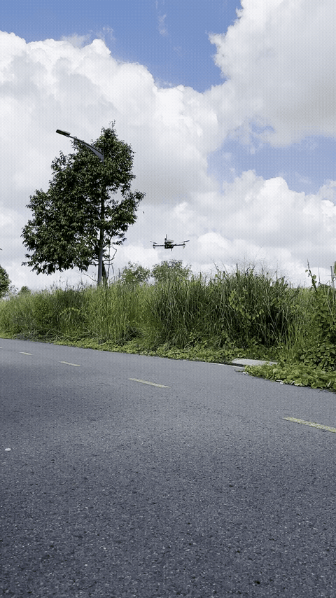
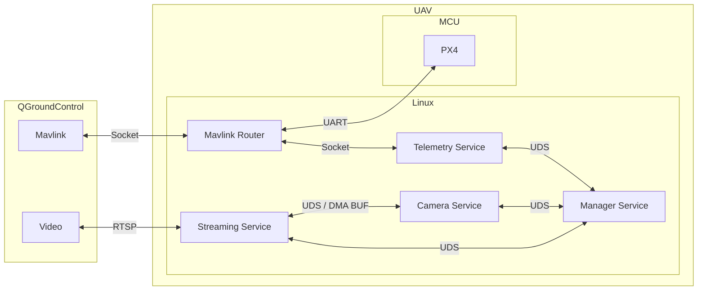

# UAV Camera

[](docs/schematics/Drone_STM+Linux_ver0.1_Schematic.pdf)
[](https://www.rock-chips.com)

[](LICENSE)

A microservice-based embedded Linux vision payload developed for the [**Custom UAV board**](docs/schematics/Drone_STM+Linux_ver0.1_Schematic.pdf) (Rockchip [RV1106](docs/datasheets/AR4236-AR4237-Luckfox-Pico-Pro-Max-Datasheet.pdf), ARM Cortex-A7 @ 1.2GHz, 128MB DDR2 RAM, 0.5 TOPS NPU).

---

## 🎥 Demo
<p align="center">
  
</p>

---

## 1. System Architecture



---

## 2. Directory Layout

```text
uav-camera/
├── cmake/                      # Toolchain definitions for RV1106/RV1103 uClibc-ng
│   └── toolchain-arm-rockchip830-uclibcgnueabihf.cmake
├── docs/                       # Technical specifications, architecture docs & diagrams
│   ├── ARCHITECTURE.md         # Comprehensive systems architecture specification
├── libs/
│   ├── camera_service/         # Sensor acquisition & VPU encoding
│   ├── manager_service/        # Process supervision & state machine
│   ├── streaming_service/      # RTSP/WebRTC video distribution
│   └── telemetry_service/      # MAVLink bridge & vehicle metrics
├── scripts/                    # Automated scripts
├── services/                   # All services
├── CMakeLists.txt              # Top-level CMake build configuration
├── LICENSE
└── README.md
```

---

## 3. Build, Cross-Compilation & Deployment

### Prerequisites
- **Host OS**: Linux Ubuntu 22.04 LTS (x86_64)
- **Cross Toolchain**: `arm-rockchip830-linux-uclibcgnueabihf` (Rockchip RV1106 Linux SDK / Buildroot Toolchain)
- **CMake**: Version >= 3.16

### Quick Start

1. **Cross-compile for Luckfox Pico Pro:**

```bash
./scripts/build_cross_rockchip.sh
# Or for Debug build:
./scripts/build_cross_rockchip.sh debug
```

## 4. License

This project is licensed under the MIT License. See [LICENSE](LICENSE) for details.
